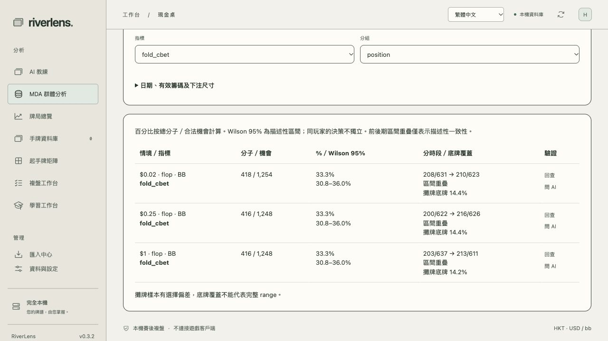

<div align="center">

# RiverLens

**Your hands. Your data. A local workspace for post-session poker review.**

Import your own hand histories from 20+ rooms, study population tendencies,
find leaks with real evidence, and drill them into memory — all offline,
on your machine, with nothing sent anywhere unless you switch it on.

[](https://github.com/G-Loop-co/riverlens/releases/latest)
[](https://github.com/G-Loop-co/riverlens/actions/workflows/desktop.yml)


**[⬇️ Download RiverLens v0.6.1](https://github.com/G-Loop-co/riverlens/releases/latest)** ·
Windows installer · macOS Apple Silicon · macOS Intel

<sub>macOS builds are ad-hoc signed, not notarized. [Release notes](docs/release-v0.6.1.md).</sub>


</div>

[English](README.md) · [繁體中文](README.zh-TW.md) · [简体中文](README.zh-CN.md) · [日本語](README.ja.md) · [한국어](README.ko.md) · [Français](README.fr.md) · [Deutsch](README.de.md) · [Español](README.es.md) · [Português (Brasil)](README.pt-BR.md) · [Italiano](README.it.md) · [Nederlands](README.nl.md) · [Polski](README.pl.md) · [Türkçe](README.tr.md)

---

## Why RiverLens

| | |
| --- | --- |
| 🔒 **Local-first, by design** | Personal review lives in SQLite, population research in independent DuckDB datasets. No account, no cloud sync, no telemetry. AI and dataset sharing are opt-in and off by default. |
| 🧪 **Evidence, not vibes** | Every rate ships with its legal-opportunity denominator, Wilson 95% interval and drill-down to anonymous hands. Missing baselines are called research hypotheses — never "you leak X". |
| 🌍 **20+ rooms and networks** | Native parsers for GG/Natural8, PokerStars, WPN, 888, partypoker, Winamax, iPoker and more, cash and tournaments — see the [full table](#supported-rooms). |
| 🤖 **AI that shows receipts** | 23 local MCP tools for your own agent, or an in-app coach (OpenAI / Anthropic / Gemini / DeepSeek / OpenCode Go). Every AI claim links back to hand evidence and requires your approval. |
| 🧠 **A study loop that closes** | Spot Explorer → Leak Finder → GTO reference → Range drill → Trainer with spaced review — and now leak trend snapshots so you can see a leak shrinking. |
| 📊 **Serious numbers, honest labels** | 13 core statistics, 13×13 matrix, all-in equity with exact enumeration. What is not decision EV is labelled as not decision EV. |

## The study loop

```text
Import  →  Explore spots  →  Find leaks  →  Compare with GTO  →  Drill & review  →  Track trends
```

1. **Import** completed hands (TXT / XML / ZIP / folders) in the Import center — pause, resume, dedupe, quarantine.
2. **Explore** any decision context: position, pot type, stacks, bet sizes, board, exact action path.
3. **Find leaks** against your own targets or a GTO strategy pack, with Wilson-interval honesty about sample size.
4. **Drill**: assign action frequencies combo by combo in the Range drill, or review spaced Trainer cards built from your own decisions and AI drafts.
5. **Track**: leak trend snapshots chart whether the frequency is actually converging — and everything exports to CSV.

<details>
<summary><strong>📸 More screenshots</strong></summary>




Screenshots capture full pages at 1920px desktop width with the Paper (warm white) theme, using **240 generated hands** — not private player data. A [1920 × 1080 overview](docs/screenshots/overview-desktop-en.jpg) is also available.

</details>

## What's new in v0.6.1

- 🧭 **Six workspaces** — Today, Hands, Learn, Research, AI Coach and Data replace nine flat pages.
- 🔗 **Deep links** — workspace tabs, filters and replay steps survive refresh and back/forward navigation.
- 🧱 **Shared UI** — common shell, tabs, scope, status and empty states keep every workspace predictable.
- ♿ **Keyboard and recovery** — WAI-ARIA tabs, localized live status and route error boundaries.

<details>
<summary><strong>Previous releases</strong></summary>

- **v0.6.0** — Leak trend snapshots, study history export and full MDA localisation.
- **v0.5.0** — AI practice drafts → Trainer self-review cards; range drill against strategy-pack nodes; MDA research wizard; one-page progress dashboard.
- **v0.4.x** — MDA population analysis on independent DuckDB datasets, AI / MCP integration, multi-room cash and tournament hand histories.

[All release notes](https://github.com/G-Loop-co/riverlens/releases)

</details>

## Supported rooms

English NLHE personal review, 2–10 seats, UTF-8; cash and supported tournaments. MDA population research remains GG Regular USD NLH 6-max. Import TXT, XML, ZIP or folders — no live client connection, ever.

<details>
<summary><strong>Full room / network table</strong></summary>

| Room / network | Cash input | MTT / tournament | Support scope |
| --- | --- | --- | --- |
| GG / Natural8 | TXT | Yes | Native grammar |
| PokerStars | TXT | Yes | Native grammar |
| WPN / ACR / Black Chip / PokerKing | TXT (legacy + modern) | Modern format only | Native grammar |
| 888 / Pacific | TXT | Yes | Native grammar |
| partypoker / bwin | TXT | — | Native grammar |
| Winamax | TXT | Yes | Native grammar |
| iPoker skins | XML | Yes | Native grammar |
| CoinPoker | TXT (USDT) | — | Native grammar; synthetic proof only |
| Ignition / Bovada / Bodog | TXT | — | Native grammar |
| Unibet | TXT | — | Native grammar |
| Full Tilt | TXT | Yes | Archived native grammar |
| Cake / Revolution | TXT | — | Archived native grammar |
| OnGame | TXT | — | Archived native grammar |
| Merge / Carbon | XML | — | Archived native grammar |
| Microgaming / MPN | XML | — | Archived native grammar |
| Chico / BetOnline / SportsBetting / TigerGaming | PokerStars TXT | — | Existing complete conversion only |
| PPPoker / PokerBros / UPoker / ClubGG / X-Poker / QQPK | PokerStars TXT | — | Existing complete conversion only |
| WPT Global | PokerStars TXT | — | Existing complete conversion only |

</details>

"—" means tournament parsing is not implemented for that row. Converted rooms require an existing complete PokerStars cash export. MTT amounts are stored as CHIPS and never mixed with cash currencies; all-in chip EV is not prize money, ROI, ICM or bounty EV. [Export guides and exact limitations](docs/hand-history-formats.md).

## AI that shows its work

Two ways to bring AI in — both evidence-linked, both requiring your approval before anything is saved:

| | In-app coach | External agent (MCP) |
| --- | --- | --- |
| **Setup** | Save an API key (OpenAI, Anthropic, Gemini, DeepSeek, OpenCode Go) in AI Connections | Enable the local connection and point any stdio-MCP client (e.g. Codex) at it |
| **Key storage** | OS credential store | Your agent's own login — RiverLens holds no provider key |
| **Tools** | 5 scoped population tools + full study tools | 23 local MCP tools |
| **Output** | Evidence-linked drafts in the Learning Library | Same drafts, driven by your agent |

Live provider calls remain unverified; offline study works without any key. [Full setup and limitations](docs/ai-agent-coach.md).

<details>
<summary><strong>MDA population research in 4 steps</strong></summary>

1. Create an independent dataset and set the hand-history time zone; import GG Regular USD NLH 6-max TXT / ZIP / folders.
2. Filter stakes, positions, pot type, stacks, board and facing-bet size; postflop defaults to heads-up.
3. Read rates with legal-opportunity denominators, Wilson 95% intervals and period splits; verify with anonymous hand evidence.
4. Enable cloud AI or MCP access per dataset (off by default) and ask for adjustment directions with receipts.

The 10-million-hand synthetic benchmark passed on Apple M3 Pro: aggregate p95 **16.4 ms**, contextual p95 **1.20 s**, peak RSS **1.39 GiB**. [Complete evidence](docs/validation/mda-population-ai.md).

</details>

## What RiverLens is not

This is a trust product, so the boundaries are a feature:

- ❌ No live HUD, real-time assistance or game-client connection
- ❌ No cloud sync, accounts or telemetry — deletion means deletion
- ❌ No decision EV, GTO best-action scores or "confidence" theatre
- ❌ Not affiliated with Natural8 or GGPoker; GG's Security & Ecology Policy restricts collecting others' histories and systematic MDA sharing — RiverLens imports **your own** completed hands only, and dataset sharing stays off unless you switch it on. [Details](docs/mda-population.md).

## Roadmap

Planned directions, not commitments; no dates. Scope discipline stays the same.

### Near term (v0.6.x)

- Adaptive Trainer scheduling (FSRS) with the existing 1/3/7/14/30-day intervals as the starting point.
- Postflop drill question types from user-supplied packs or MDA population baselines, always labelled as tendencies, never GTO.

### Mid term

- Stake- and rake-aware strategy comparisons beyond NL10 100bb manifests.
- HHDealer PT / HM / H2N4 imports once real samples validate them; PHH / OHH / ACPC research formats.
- Live provider call validation and broader packaged-client smoke coverage.
- Deeper AI ↔ Trainer loop: study-plan drafts that schedule themselves into the practice deck.

### Exploring

- Tournament-aware equity context (ICM / bounty are prize-money EV and out of scope today).
- Saved MDA research templates and a shared hypothesis library.
- In-app statistics education with worked examples per metric.

### Not planned

Live HUD / real-time assistance, cloud sync of private histories, solver licensing, or decision-EV claims.

## Build from source

Requires Node.js 22+, Rust stable and the [Tauri platform prerequisites](https://v2.tauri.app/start/prerequisites/).

```sh
git clone https://github.com/G-Loop-co/riverlens.git
cd riverlens
npm ci
npm run desktop
```

1. Export your own completed hand histories (e.g. PokerCraft TXT / ZIP).
2. In **Data & settings**, confirm brand, Hero name and the hand-history time zone.
3. Import in the **Import center**, then review results, the 13×13 matrix and individual hands.

```sh
npm test          # frontend tests
npm run core:test # Rust core tests
npm run build     # strict production build
```

Data lives in the Tauri app-data directory (`app.riverlens.desktop`); the settings page shows the actual location. Use the built-in backup for an active database so SQLite WAL is handled correctly.

## Documentation

- [User guide (Traditional Chinese)](docs/user-guide.md)
- [Architecture and statistical definitions](docs/architecture.md)
- [Study workflow](docs/study-workflow.md)
- [Hand-history formats and export guides](docs/hand-history-formats.md)
- [AI coach and MCP setup](docs/ai-agent-coach.md)
- [MDA restrictions and validation gates](docs/mda-population.md)
- [Validation and limitations](docs/validation.md)
- [Changelog](CHANGELOG.md) · [Third-party components](THIRD_PARTY.md) · [All releases](https://github.com/G-Loop-co/riverlens/releases)

## Licensing

The repository is public, but a project-wide reuse license has not yet been selected. Do not assume MIT or Apache licensing for RiverLens itself. Third-party components retain their respective licenses; see [THIRD_PARTY.md](THIRD_PARTY.md).
