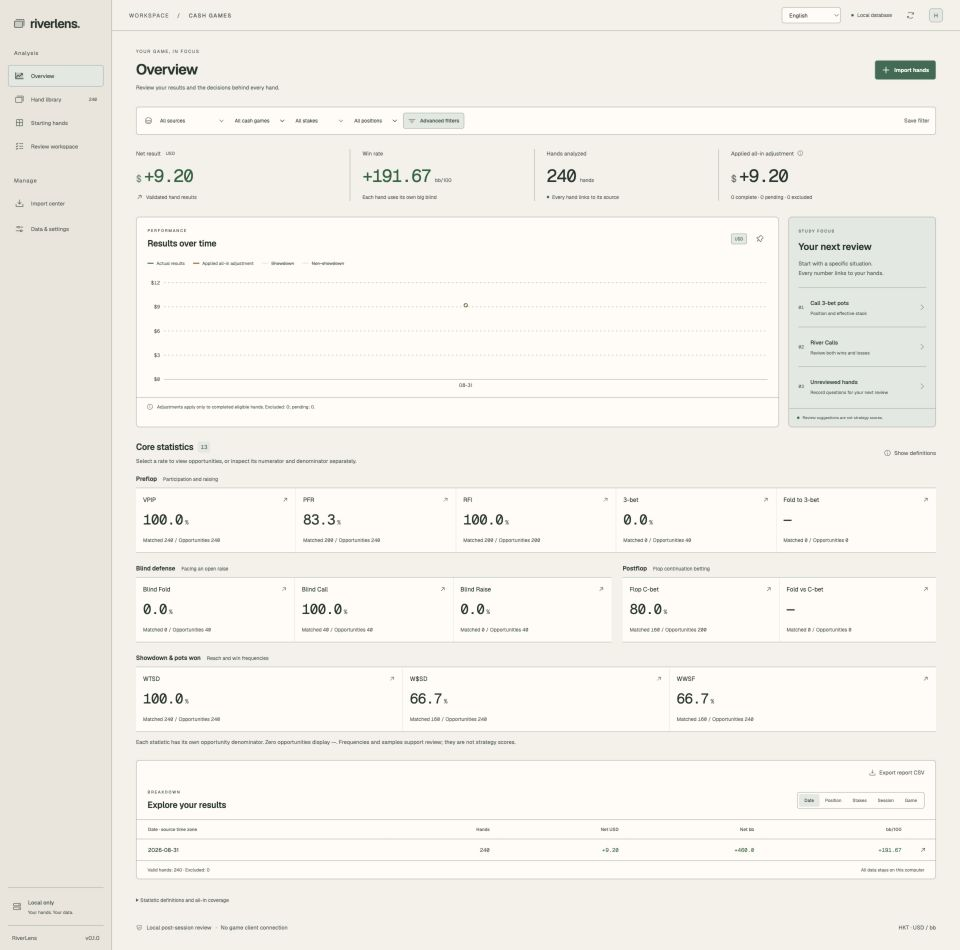

# RiverLens

New in **v0.4.0: MDA population analysis with AI evidence**. Import independent GG Regular USD NLH 6-max datasets into local DuckDB, filter population tendencies and verify Coach / MCP suggestions with anonymous hands. Dataset sharing is off by default. [Release details](docs/release-v0.4.0.md) · [Statistical definitions and platform restrictions](docs/mda-population.md).

**Your hands. Your data. A local workspace for post-session poker review.**

[English](README.md) · [繁體中文](README.zh-TW.md) · [简体中文](README.zh-CN.md) · [日本語](README.ja.md) · [한국어](README.ko.md) · [Français](README.fr.md) · [Deutsch](README.de.md) · [Español](README.es.md) · [Português (Brasil)](README.pt-BR.md) · [Italiano](README.it.md) · [Nederlands](README.nl.md) · [Polski](README.pl.md) · [Türkçe](README.tr.md)

RiverLens is a Tauri desktop application for reviewing your own completed cash-game and supported tournament hand histories from multiple rooms, alongside independent MDA population datasets. React and TypeScript power the interface; a Rust core handles parsing and statistics, with personal review in SQLite and MDA in DuckDB.

> **[Download v0.5.0](https://github.com/G-Loop-co/riverlens/releases/tag/v0.5.0)** — MDA + AI, local MCP and offline study. Windows, Apple Silicon and Intel Mac packages. macOS downloads are ad-hoc signed, not notarized. [Release notes](docs/release-v0.5.0.md).



README translations: **13 languages**. Personal-review interface: **English, Traditional Chinese and Simplified Chinese**; the first MDA workspace uses **Traditional Chinese labels**.

**v0.4.0** adds population research alongside AI-assisted personal review and Spot Explorer → Leak Finder → Preflop reference → Trainer. User-supplied strategy packs are required for strategy comparisons; frequencies are not decision EV. [Study workflow](docs/study-workflow.md) · [Themes](docs/theme-selection.md).

**v0.5.0** closes the study loop: AI practice drafts convert into Trainer self-review cards, a range drill quizzes action frequencies against strategy-pack nodes, the MDA research wizard walks hypothesis → Wilson-interval stats → anonymous hand verification → AI exploitation analysis, and a one-page progress dashboard collects practice, drill and leak-target status. Descriptive observations only; frequencies are not EV.

## Personal-review hand-history formats (v0.5.0)

English NLHE, 2–10 seats, UTF-8. These formats apply to personal review; MDA remains GG Regular USD NLH 6-max. Import TXT, XML, ZIP or folders. “Native” means an implemented room grammar; it does not certify every current client version. [Export guides, sources and exact limitations](docs/hand-history-formats.md).

| Room / network | Cash input | MTT / tournament | Support scope |
| --- | --- | --- | --- |
| GG / Natural8 | TXT | Yes | Native grammar |
| PokerStars | TXT | Yes | Native grammar |
| WPN / ACR / Black Chip / PokerKing | TXT (legacy + modern) | Modern format only | Native grammar |
| 888 / Pacific | TXT | Yes | Native grammar |
| partypoker / bwin | TXT | — | Native grammar |
| Winamax | TXT | Yes | Native grammar |
| iPoker skins | XML | Yes | Native grammar |
| CoinPoker | TXT (USDT) | — | Native grammar; synthetic proof only |
| Ignition / Bovada / Bodog | TXT | — | Native grammar |
| Unibet | TXT | — | Native grammar |
| Full Tilt | TXT | Yes | Archived native grammar |
| Cake / Revolution | TXT | — | Archived native grammar |
| OnGame | TXT | — | Archived native grammar |
| Merge / Carbon | XML | — | Archived native grammar |
| Microgaming / MPN | XML | — | Archived native grammar |
| Chico / BetOnline / SportsBetting / TigerGaming | PokerStars TXT | — | Existing complete conversion only |
| PPPoker / PokerBros / UPoker / ClubGG / X-Poker / QQPK | PokerStars TXT | — | Existing complete conversion only |
| WPT Global | PokerStars TXT | — | Existing complete conversion only |

“—” means tournament parsing is not implemented for that row. Converted rooms require an existing complete PokerStars cash export; RiverLens does not capture or convert their native histories. WPN modern Cash and CoinPoker native Cash still lack real-sample native-app validation in this run. Historical names do not imply that a room still operates. Other researched rooms and PHH / OHH / ACPC are not implemented.

MTT amounts are stored as CHIPS, with tournament ID, level and source buy-in text when available. Chips and cash currencies stay separate. All-in chip EV is not prize money, ROI, ICM or bounty EV. Native validation on a v0.3.2-based test app covers 13 public Cash samples, seven tournament grammars and preserved own Cash/Rush histories; four incompatible tournament samples remain rejected. The v0.4.0 integration has separate source regression results in the linked guide. These changes are included in v0.5.0; see the release notes for packaging validation and remaining acceptance limits.

## Features

| Feature | What you can do |
| --- | --- |
| AI coach and agent connection | Explore statistics and decision context through 23 local MCP tools; create evidence-linked review, practice and study-plan drafts for your approval. |
| MDA population analysis | Import independent GG Regular datasets; filter legal all-player opportunities, inspect confidence intervals and research hypotheses, then verify anonymous hand evidence. |
| Import center | Import TXT, XML, ZIP or folders; monitor progress, pause/resume, detect duplicates and inspect quarantined records. |
| Results dashboard | Explore net results, bb/100, session and position breakdowns; drill into underlying hands. |
| 13 core statistics | Review VPIP, PFR, RFI, 3-bet, blind defense and postflop/showdown frequencies with explicit opportunity denominators. |
| 13 × 13 starting-hand matrix | Inspect observed hand counts, net bb, bb/100 and action frequency; open the matching hand list. |
| Hand replayer | Step through actions, jump streets and replay known cards. |
| Review workspace | Save notes, tags, reviewed status and reusable filters. |
| Data ownership | Keep personal review in SQLite and MDA in independent DuckDB datasets; export personal CSV / hand histories and back up or restore each data store. |
| Appearance themes | Choose Forest, Midnight or Paper (warm white); the selection persists locally. |
| Personal-review languages | Switch between English, Traditional Chinese and Simplified Chinese offline; MDA workspace labels currently use Traditional Chinese. |
| Eligible all-in equity | Calculate supported heads-up, single-pot, known-hole-card, single-runout situations. This is not decision EV or a GTO score. |


Screenshots capture the complete page at **1920px desktop width**, using the **Paper (warm white)** theme. A [1920 × 1080 overview](docs/screenshots/overview-desktop-en.jpg) is also available.

Screenshots use **240 generated hands**, not private player data. The deliberately repetitive fixture is for demonstrating the interface, not realistic frequencies or strategy advice. The matrix describes observed hands, not a recommended range.

## Roadmap

Planned directions, not commitments; no dates. Scope discipline stays the same: local-first, no live HUD / real-time assistance / cloud sync, and frequencies are never decision EV.

### Near term (v0.5.x)

- Adaptive Trainer scheduling (FSRS) with the existing 1/3/7/14/30-day intervals as the starting point.
- Leak trend snapshots: saved benchmarks tracked over time so improvement per context is visible instead of a single snapshot.
- Postflop drill question types from user-supplied packs or MDA population baselines, always labelled as tendencies, never GTO.
- Practice and drill history export (CSV) for self-analysis.
- MDA workspace labels in English and Simplified Chinese.

### Mid term

- Stake- and rake-aware strategy comparisons beyond NL10 100bb manifests.
- HHDealer PT / HM / H2N4 imports once real samples validate them; PHH / OHH / ACPC research formats.
- Live provider call validation and broader packaged-client smoke coverage.
- Deeper AI ↔ Trainer loop: study-plan drafts that schedule themselves into the practice deck.

### Exploring

- Tournament-aware equity context (ICM / bounty are prize-money EV and out of scope today).
- Saved MDA research templates and a shared hypothesis library.
- In-app statistics education with worked examples per metric.

### Not planned

Live HUD / real-time assistance, cloud sync of private histories, solver licensing, or decision-EV claims.

## MDA + AI quick start

1. Open **MDA 群體分析**, create a dataset and set its source and hand-history time zone. Import GG Regular USD NLH 6-max TXT, ZIP or a folder; use the import tab to pause/resume or inspect quarantined records.
2. Select stakes, positions, pot type, effective stacks, board and facing-bet size. Postflop research defaults to heads-up spots. Read each rate with its legal-opportunity denominator and anonymous hand evidence.
3. For the in-app Coach, enable this dataset's cloud sharing and the existing provider consent, then select a provider/model. For an external agent, enable this dataset's MCP access and the local connection. Both dataset permissions start off.
4. Ask for context, counts, adjustment direction and sizing, reasons, exceptions and anonymous examples. Review the evidence-linked draft in the dataset's AI tab and replay its hands.

The 10-million-hand synthetic benchmark passed on Apple M3 Pro: aggregate p95 **16.4 ms**, contextual p95 **1.20 s**, peak process RSS **1.39 GiB**. These are two documented core queries with warm OS cache, excluding desktop UI, IPC and provider latency. [Complete source, hardware, correctness and performance evidence](docs/validation/mda-population-ai.md).

Missing baselines are research hypotheses. Shown-card samples expose coverage and selection bias. Pure-bluff break-even arithmetic applies only to its stated heads-up river assumptions; it is not solver or decision EV output. HHDealer PT/HM/H2N4, live provider and external model-client compatibility still require real samples or live testing.


## AI: features and quick start

Ask about your statistics, inspect a specific decision, find spots worth reviewing, and create practice or study-plan drafts linked to hand evidence. Drafts require your approval; AI and offline study libraries currently remain separate.

**Use an external agent — no provider API key in RiverLens:**

1. Import completed hands and keep RiverLens open.
2. Open **AI Coach → AI Connections → Enable local connection**. Copy the displayed configuration into a client supporting **stdio MCP**, such as Codex.
3. Ask: “Review my biggest leak candidates, show sample sizes and supporting hands, then create a practice draft.” Review and accept drafts in **Learning Library**.

Your agent may need its own login/subscription. Update the connection configuration after restarting RiverLens; **Revoke connection** disables access.

**Use the in-app coach — API key required:** save an OpenAI, Anthropic, Gemini, DeepSeek or OpenCode Go key in **AI Connections**, then choose a compatible model and sharing scope in **AI Coach**. Ask a question, or use **Ask AI** from the hand replayer.

Selected context can be sent to the model provider, including through an external agent. Keys stay in the OS credential store. Live provider calls remain unverified; offline study works without a key. [Full setup and limitations](docs/ai-agent-coach.md).

### Supported AI connections

These are the five implemented in-app providers. Choose an account-accessible model with tool calling; integration support does not mean every model has been live-tested.

| Provider | Models / API | Setup |
| --- | --- | --- |
| OpenAI | Tool-capable GPT models using Chat Completions | OpenAI API key |
| Anthropic | Tool-capable Claude models using Messages | Anthropic API key |
| Google Gemini | Tool-capable Gemini models using streamGenerateContent | Gemini API key |
| DeepSeek | `deepseek-flash`, `deepseek-v4-pro`; accepted legacy aliases depend on the provider | DeepSeek API key |
| OpenCode Go | GLM, Kimi, LongCat, DeepSeek, MiMo, Hy, MiniMax, Qwen, Grok, GPT and Muse; routed by model family | Go subscription and API key |

**External agents:** clients supporting local **stdio MCP**, such as Codex, can use RiverLens tools through the displayed connection configuration. This is a protocol connection, not a built-in provider or a guarantee that every client has been tested. The client supplies its own model/login; RiverLens needs no provider key for this path.

<details>
<summary>OpenCode Go model IDs and automatic API routing</summary>

| API | Model IDs |
| --- | --- |
| Chat Completions | `glm-5.3-flash`, `glm-5.3`, `glm-5.2`, `glm-5.1`, `kimi-k3`, `kimi-k2.7-code`, `kimi-k2.6`, `longcat-2.0`, `deepseek-v4.1-flash`, `deepseek-v4-pro`, `deepseek-v4-flash`, `deepseek-v4-flash-vision-exp`, `mimo-v2.5`, `mimo-v2.5-pro`, `hy4-preview`, `hy3` |
| Messages | `minimax-m3`, `minimax-m2.7`, `minimax-m2.5`, `qwen3.8-max`, `qwen3.8-flash`, `qwen3.7-max`, `qwen3.7-plus`, `qwen3.6-plus` |
| Responses | `grok-4.6`, `gpt-5.6-luna`, `muse-spark-1.3-contributor`, `muse-spark-1.2-contributor` |

</details>

Model catalogs change: check [DeepSeek](https://api-docs.deepseek.com/quick_start/pricing/) and [OpenCode Go](https://opencode.ai/docs/go/#endpoints) for current access and IDs. Enter the bare ID, without `opencode-go/`. Go is intended for coding-agent traffic; RiverLens poker coaching eligibility and live compatibility are unverified. Vision-capable models receive text only.

## Quick start

Requires Node.js 22+, Rust stable and the [Tauri platform prerequisites](https://v2.tauri.app/start/prerequisites/) (Xcode Command Line Tools on macOS; MSVC C++ Build Tools and WebView2 on Windows).

```sh
git clone https://github.com/G-Loop-co/riverlens.git
cd riverlens
npm ci
npm run desktop
```

1. Export your own completed hand histories from PokerCraft as TXT or ZIP.
2. In **Data & settings**, confirm the brand, Hero name and the time zone used inside the hand-history text.
3. Import files in **Import center**.
4. Review results, inspect the starting-hand matrix and replay individual hands.
5. Save notes and back up your database.

## Development

```sh
# Terminal 1: local Rust HTTP core, bound to 127.0.0.1
npm run serve:core
# Terminal 2: browser preview at http://127.0.0.1:1420
npm run dev
```

The desktop app uses Tauri IPC and native file dialogs. The browser preview uses the same Rust core with development-only file path entry.

```sh
npm test
npm run core:test
npm run build
node scripts/cargo.mjs clippy -p poker-core --all-targets -- -D warnings
npm run desktop:build -- --bundles app
# On a Windows native runner:
npm run desktop:build -- --target x86_64-pc-windows-msvc --bundles nsis
```

Data lives in the Tauri app-data directory (`app.riverlens.desktop`); the settings page shows the actual location. Browser development uses `.local/riverlens.db`. Use the built-in backup operation for an active database so SQLite WAL data is handled correctly.

## Scope and release status

RiverLens supports offline personal post-session review and MDA population research. It does not connect to the game client and provides no live HUD, real-time assistance, cloud sync or GTO best-action scoring. It is not affiliated with Natural8 or GGPoker. GG's Security & Ecology Policy sections 7 and 19 restrict collecting other players' histories and collecting/sharing MDA; penalties can include suspension, bans and confiscation of funds. See the [MDA restrictions and validation gates](docs/mda-population.md).

The v0.4.0 release includes MDA, AI/MCP integration and the offline study workflow. Private hand histories, local databases and strategy packs are excluded. See the [release notes](docs/release-v0.4.0.md) for validation limits.

- [User guide (Traditional Chinese)](docs/user-guide.md)
- [Architecture and statistical definitions](docs/architecture.md)
- [Research and existing components](docs/research-matrix.md)
- [Validation and limitations](docs/validation.md)
- [Changelog](CHANGELOG.md)
- [Third-party components](THIRD_PARTY.md)
- [Releases](https://github.com/G-Loop-co/riverlens/releases)

## Licensing

The repository is public, but a project-wide reuse license has not yet been selected. Do not assume MIT or Apache licensing for RiverLens itself. Third-party components retain their respective licenses; see [THIRD_PARTY.md](THIRD_PARTY.md).
