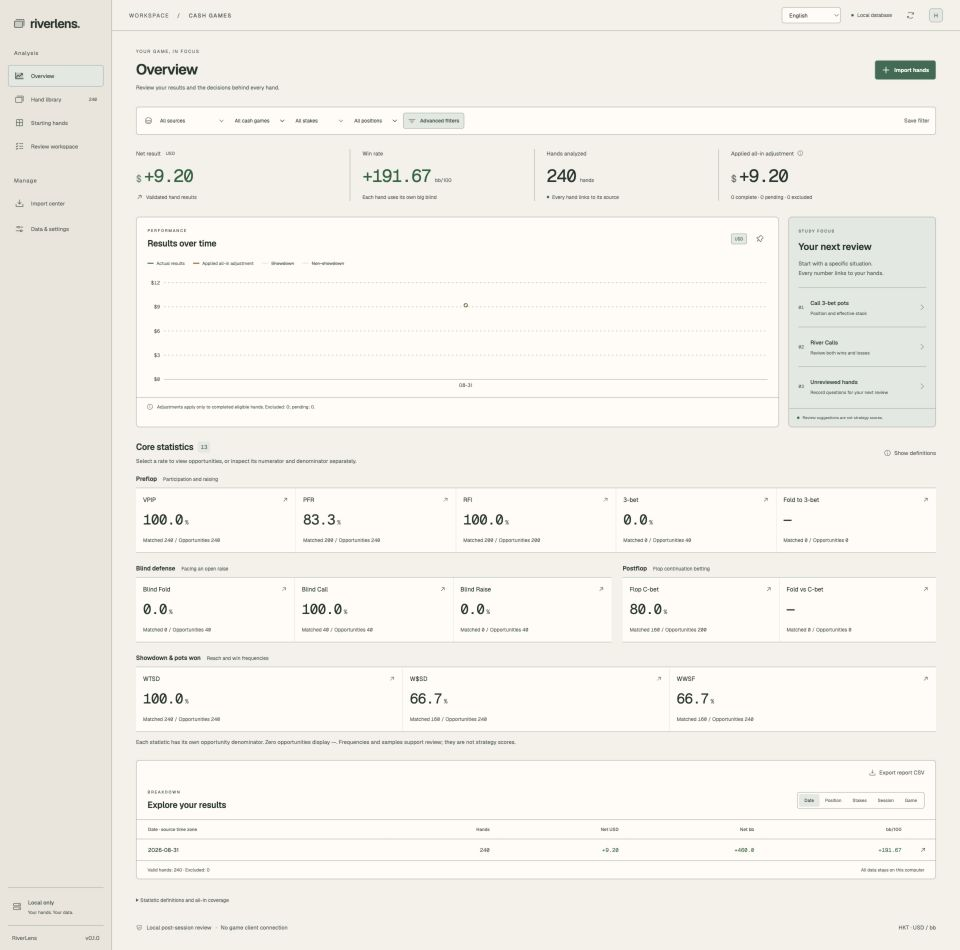
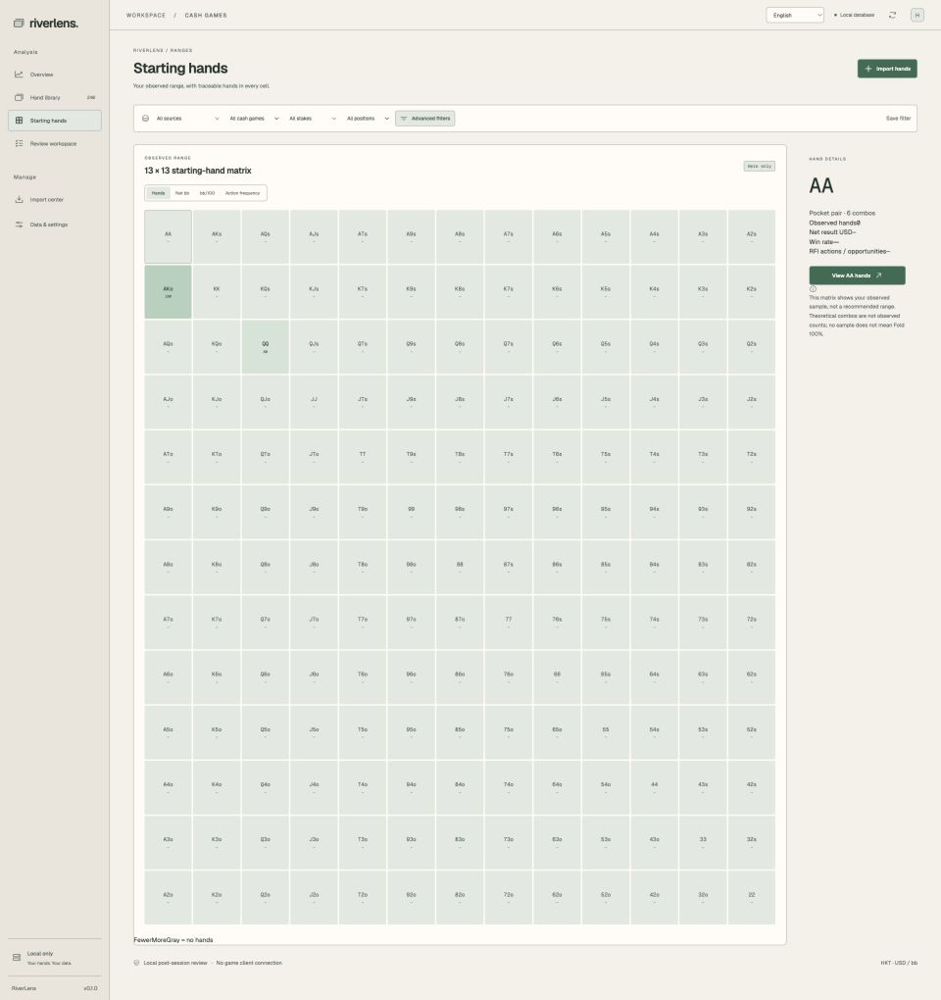

<div align="center">

# RiverLens

**Jouw handen. Jouw data. Een lokale workspace voor poker-review na je sessie.**

Importeer eigen handhistories uit 20+ kamers, bestudeer populatietendsen, vind leaks met echt bewijs en veranker ze met drill — volledig offline, op je eigen machine.

[](https://github.com/G-Loop-co/riverlens/releases/latest)
[](https://github.com/G-Loop-co/riverlens/actions/workflows/desktop.yml)


**[⬇️ RiverLens v0.6.2 downloaden](https://github.com/G-Loop-co/riverlens/releases/latest)**

<sub>macOS-builds zijn ad-hoc ondertekend, niet notarized.</sub>



</div>


[English](README.md) · [繁體中文](README.zh-TW.md) · [简体中文](README.zh-CN.md) · [日本語](README.ja.md) · [한국어](README.ko.md) · [Français](README.fr.md) · [Deutsch](README.de.md) · [Español](README.es.md) · [Português (Brasil)](README.pt-BR.md) · [Italiano](README.it.md) · [Nederlands](README.nl.md) · [Polski](README.pl.md) · [Türkçe](README.tr.md)

---

## Functies

- Importeer TXT, ZIP of mappen; bekijk voortgang, pauzeer/hervat, detecteer duplicaten en isoleer afwijkende records.
- Nettoresultaten, bb/100 en uitsplitsingen per sessie of positie, met toegang tot de handen.
- 13 statistieken: VPIP, PFR, RFI, 3-bet, blindverdediging en postflop-/showdownfrequenties met aparte tellers en aantallen handelingsmogelijkheden als noemers.
- 13 × 13 starthandmatrix: aantallen, net bb, bb/100 en actiefrequentie.
- Speel acties stap voor stap af, wissel van street en bekijk bekende kaarten.
- Bewaar notities, tags, reviewstatus en filters.
- Lokale SQLite, CSV-/handexport, back-up en herstel.
- Thema’s Forest, Midnight en Paper (warm wit), met lokaal opgeslagen keuze.
- All-in-equity voor ondersteunde heads-up-situaties met één pot, bekende holecards en één runout. Geen decision EV of GTO-score.

## Schermafbeeldingen

Volledige pagina’s in Paper-thema, op 1920px breedte. Alleen 240 synthetische handen, zonder privégegevens. Frequenties en winsten van deze herhaalde voorbeelden zijn geen echte spelersresultaten. De matrix toont waargenomen handen, geen aanbevolen range.




## Aan de slag

Vereist Node.js 22+, Rust stable en Tauri-platformtools: Xcode Command Line Tools op macOS; MSVC C++ Build Tools en WebView2 op Windows.

[Tauri](https://v2.tauri.app/start/prerequisites/)

```sh
git clone https://github.com/G-Loop-co/riverlens.git
cd riverlens
npm ci
npm run desktop
```

1. Exporteer je eigen afgeronde handen uit PokerCraft als TXT / ZIP.
2. Controleer in Data & settings het merk, de Hero-naam en de tijdzone in de handtekst.
3. Importeer via Import center en bekijk resultaten, matrix en replays.
4. Bewaar notities en maak regelmatig een back-up.

## Ontwikkeling

Start Rust core in terminal 1 en het browservoorbeeld in terminal 2. De desktopapp gebruikt Tauri IPC en native bestandsvensters; het voorbeeld gebruikt dezelfde kern met padinvoer voor ontwikkeling.

```sh
# Terminal 1
npm run serve:core
# Terminal 2 — http://127.0.0.1:1420
npm run dev
```

```sh
npm test
npm run core:test
npm run build
node scripts/cargo.mjs clippy -p poker-core --all-targets -- -D warnings
npm run desktop:build -- --bundles app
# Windows
npm run desktop:build -- --target x86_64-pc-windows-msvc --bundles nsis
```

Gegevens staan in de Tauri-app-data-map (app.riverlens.desktop); instellingen tonen het werkelijke pad. Browserontwikkeling gebruikt .local/riverlens.db. Gebruik voor actieve SQLite de ingebouwde back-up zodat WAL-gegevens worden meegenomen.

## Reikwijdte en licentie

Voor persoonlijke offline analyse na de sessie. Geen verbinding met de spelclient, live-HUD, RTA, cloudsynchronisatie of GTO-beoordeling van de beste actie. Niet verbonden aan Natural8 / GGPoker. De repository is openbaar, maar er is nog geen projectbrede hergebruiklicentie gekozen. Ga niet uit van MIT / Apache voor RiverLens zelf. Derden behouden hun eigen licenties.

## Documentatie

[User guide — 繁體中文](docs/user-guide.md) · [Architecture](docs/architecture.md) · [Validation](docs/validation.md) · [Research](docs/research-matrix.md) · [Changelog](CHANGELOG.md) · [Third-party components](THIRD_PARTY.md) · [Releases](https://github.com/G-Loop-co/riverlens/releases)
