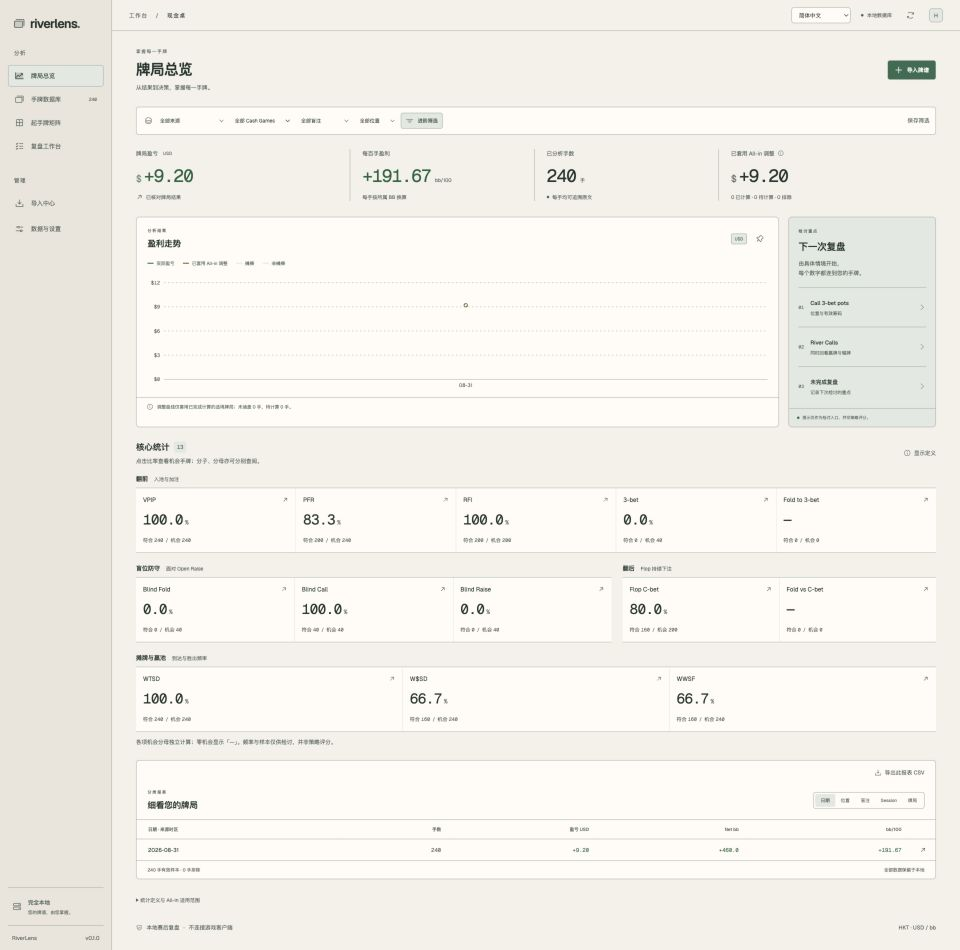
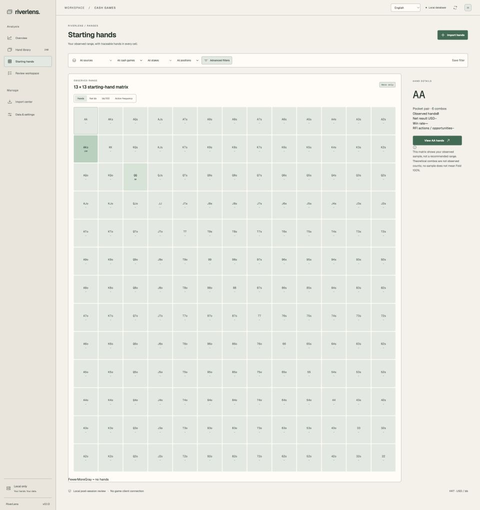
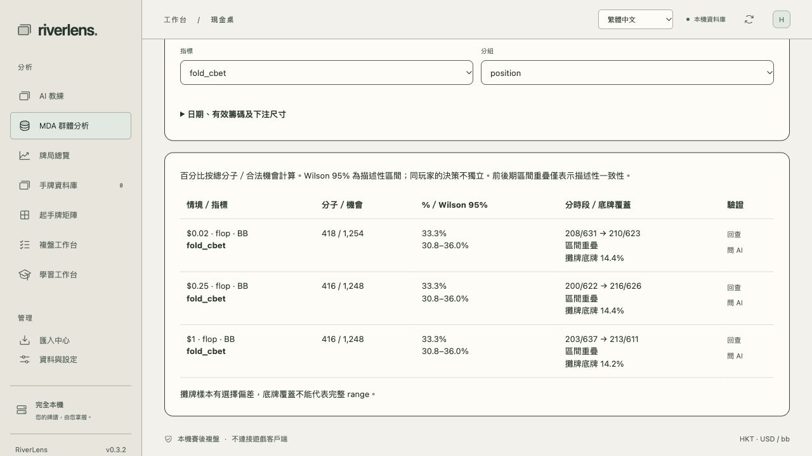

# RiverLens

**v0.4.0：MDA 群体分析＋AI 证据建议**。支援 GG 一般桌 USD NLH 6-max、独立 DuckDB 资料集、情境统计与匿名回放，内建 Coach／MCP 共用证据工具。资料集分享预设关闭。[版本详情](docs/release-v0.4.0.md) · [统计定义与平台限制](docs/mda-population.md)。

**您的牌谱，由您掌握。以本机资料为本的赛后 Poker 复盘工作台。**

[English](README.md) · [繁體中文](README.zh-TW.md) · [简体中文](README.zh-CN.md) · [日本語](README.ja.md) · [한국어](README.ko.md) · [Français](README.fr.md) · [Deutsch](README.de.md) · [Español](README.es.md) · [Português (Brasil)](README.pt-BR.md) · [Italiano](README.it.md) · [Nederlands](README.nl.md) · [Polski](README.pl.md) · [Türkçe](README.tr.md)

RiverLens 是 多牌室个人现金桌及指定锦标赛牌谱与独立 MDA 群体资料分析桌面工具。介面使用 React／TypeScript，Rust core 负责解析及统计；个人资料存 SQLite，MDA 资料集存 DuckDB。

> **[下载 v0.5.0](https://github.com/G-Loop-co/riverlens/releases/tag/v0.5.0)** — MDA＋AI、本机 MCP 及离线学习。提供 Windows、Apple Silicon、Intel Mac 套件。macOS 为 ad-hoc 签章，未经 Apple notarization。[发布说明](docs/release-v0.5.0.md)。



README 共 **13 种语言**；个人复盘介面支援 **English／繁中／简中**，首版 **MDA 工作区标签使用繁体中文**。

**v0.4.0** 新增群体研究，保留 AI 个人复盘及 Spot Explorer → Leak Finder → 翻前策略对照 → Trainer。策略包需自行提供；频率对照不是 decision EV。[学习工作台](docs/study-workflow.md) · [主题](docs/theme-selection.md)。

**v0.5.0** 打通学习闭环：AI 练习草稿可整批转为 Trainer 自行复盘题卡；新增 Range 操练对照策略包节点频率；MDA 研究向导按假设 → Wilson 区间 → 匿名手牌验证 → AI 剥削分析逐步引导；学习进度仪表板集中练习、操练与 leak 目标状态。均为描述性观察，频率不是 EV。

## 个人复盘牌谱格式（v0.5.0）

英文 NLHE、2–10 席、UTF-8；以下格式适用于个人复盘，MDA 维持 GG 一般桌 USD NLH 6-max 范围；可导入 TXT、XML、ZIP 或文件夹。“原生”表示已实现牌室语法，不代表每个现行客户端版本均已验收。[导出指南、公开来源及完整限制](docs/hand-history-formats.md)。

| 牌室／网络 | Cash 输入 | MTT／锦标赛 | 支持范围 |
| --- | --- | --- | --- |
| GG / Natural8 | TXT | 支持 | 原生语法 |
| PokerStars | TXT | 支持 | 原生语法 |
| WPN / ACR / Black Chip / PokerKing | TXT (legacy + modern) | 仅 modern 格式 | 原生语法 |
| 888 / Pacific | TXT | 支持 | 原生语法 |
| partypoker / bwin | TXT | — | 原生语法 |
| Winamax | TXT | 支持 | 原生语法 |
| iPoker skins | XML | 支持 | 原生语法 |
| CoinPoker | TXT (USDT) | — | 原生语法；仅合成验证 |
| Ignition / Bovada / Bodog | TXT | — | 原生语法 |
| Unibet | TXT | — | 原生语法 |
| Full Tilt | TXT | 支持 | 历史原生语法 |
| Cake / Revolution | TXT | — | 历史原生语法 |
| OnGame | TXT | — | 历史原生语法 |
| Merge / Carbon | XML | — | 历史原生语法 |
| Microgaming / MPN | XML | — | 历史原生语法 |
| Chico / BetOnline / SportsBetting / TigerGaming | PokerStars TXT | — | 仅已有完整转换文件 |
| PPPoker / PokerBros / UPoker / ClubGG / X-Poker / QQPK | PokerStars TXT | — | 仅已有完整转换文件 |
| WPT Global | PokerStars TXT | — | 仅已有完整转换文件 |

“—”表示该行未实现锦标赛解析。转换牌室须先持有完整 PokerStars cash 导出文件；RiverLens 没有实现其原生 capture 或 converter。WPN modern Cash 与 CoinPoker 原生 Cash 仍缺本次原生真实样本验证。历史名称不表示牌室仍在运营。其他研究中的牌室及 PHH／OHH／ACPC 尚未实现。

MTT 以 CHIPS 保存筹码；可用时保留赛事编号、级别及 Buy-in 原文，现金币种与筹码分开。All-in chip EV 不代表奖金、ROI、ICM 或 bounty EV。v0.3.2 基底的测试 App 原生验证涵盖 13 份公开 Cash 样本、7 种锦标赛语法及原有 Cash／Rush 原文；4 手不兼容锦标赛样本仍拒收。v0.4.0 整合的源代码回归另列于上述指南。v0.5.0 包含此功能；打包验证及尚未完成的验收见发布说明。

## 功能

| 功能 | 用途 |
| --- | --- |
| AI 教练与 agent 连接 | 透过 23 个本机 MCP 工具查阅统计与决策情境，建立附手牌依据的复盘、练习及学习计划草稿，由您确认。 |
| MDA 群体分析 | 汇入独立 GG 一般桌资料集；按情境分析全桌合法机会、Wilson 区间及研究假设，点开匿名手牌验证。 |
| 汇入中心 | 汇入 TXT、XML、ZIP 或资料夹；查看进度、暂停／续汇、去重及异常隔离。 |
| 盈亏总览 | 查看净盈亏、bb/100、Session 与位置分类，点入原始手牌。 |
| 13 项核心统计 | VPIP、PFR、RFI、3-bet、盲位防守及翻后／摊牌频率；分子、机会分母可分别查阅。 |
| 13 × 13 起手牌矩阵 | 查看实际样本、net bb、bb/100、行动频率，开启对应手牌。 |
| 手牌回放 | 逐步行动、跳街、自动播放及已知底牌。 |
| 复盘工作台 | 保存笔记、标签、已复盘状态及常用筛选。 |
| 本机资料管理 | 个人 SQLite、独立 MDA DuckDB；个人 CSV／牌谱汇出，各资料库独立备份还原。 |
| 外观主题 | 森林绿、午夜蓝、暖白；选择储存于本机。 |
| 个人复盘三语介面 | 繁中、简中及 English，离线可用；MDA 工作区目前使用繁体中文标签。 |
| 适用 All-in equity | 支援单挑、单底池、已知底牌、单 runout 的适用情况；不是 decision EV 或 GTO 评分。 |



截图采 **1920px 桌面宽度、完整页面、暖白主题**；另提供 [1920 × 1080 完整视窗](docs/screenshots/overview-desktop-en.jpg)。

截图全部使用 **240 手合成资料**，不包含私人牌谱。重复样本仅示范介面，不代表真实玩家频率或策略建议。矩阵呈现已观察手牌，并非建议范围。

## MDA＋AI 快速上手

1. 开启「**MDA 群体分析**」，建立资料集并指定来源、牌谱内文时区；汇入 GG 一般桌 USD NLH 6-max 的 TXT、ZIP 或资料夹。汇入页可暂停／续汇及查看隔离纪录。
2. 筛选级别、位置对位、pot type、有效筹码、牌面及面对下注尺寸。翻后研究预设 HU；每个百分比配合合法机会分母及匿名手牌阅读。
3. 内建 Coach：启用此资料集的云端分享及既有 provider 分享同意，选择 provider／model。外部 agent：启用此资料集的 MCP 权限及本机连接。两种资料集权限均预设关闭。
4. 要求适用情境、分子／分母、调整方向及尺寸、理由、例外与匿名案例；在资料集的 AI 页审阅草稿，再回放证据手牌。

Apple M3 Pro 的 **1,000 万手合成资料验收通过**：汇总 p95 **16.4 ms**、情境查询 **1.20 秒**、程序峰值 RSS **1.39 GiB**。范围为两组指定核心查询、暖 OS cache，不包含桌面 UI／IPC／provider 延迟。[来源、硬体、正确性与完整效能纪录](docs/validation/mda-population-ai.md)。

没有基准时标示研究假设；摊牌样本显示复盖率与选择偏差。纯 bluff 门槛只适用于列明假设的 HU river 情境，不是 Solver 或 decision EV。HHDealer PT／HM／H2N4、真实 provider 及外部模型客户端仍待真实样本或实测。



## AI 功能与快速上手

查阅统计、分析指定决策、找出值得检讨的局面，并建立附手牌依据的练习或学习计划草稿。草稿需由您确认；AI 与原有离线学习资料库目前分开。

**使用外部 agent：RiverLens 不需要 provider API key**

1. 汇入已完成的牌谱，保持 RiverLens 开启。
2. 开启「**AI 教练 → AI 连接 → 启用本机连接**」，将显示的设定复制到支援 **stdio MCP** 的客户端，例如 Codex。
3. 输入：「找出最值得检讨的 leak candidates，列出样本量及手牌依据，再建立练习草稿。」到「**学习资料**」检视并确认草稿。

外部 agent 可能需要自己的登入／订阅。重启 RiverLens 后需更新连接设定；「**撤销连接**」可停止存取。

**使用 App 内 AI 教练：需要 API key**

在「**AI 连接**」储存 OpenAI、Anthropic、Gemini、DeepSeek 或 OpenCode Go key，再于「**AI 教练**」选择相容 model、分享范围并提问；亦可从手牌回放按「**问 AI**」。

选定内容可能传送至模型供应商，包括经外部 agent 传送。Key 存于系统凭证库。云端供应商实际呼叫尚未验证；无 key 仍可使用离线学习。[完整设定与限制](docs/ai-agent-coach.md)。

### 支援的 AI 连接

App 已实作以下五个供应商。请选择帐户可用、支援工具呼叫的模型；已实作 API 不代表所有模型均已实测。

| 供应商 | 模型／API | 设定 |
| --- | --- | --- |
| OpenAI | 支援工具的 GPT 模型；Chat Completions | OpenAI API key |
| Anthropic | 支援工具的 Claude 模型；Messages | Anthropic API key |
| Google Gemini | 支援工具的 Gemini 模型；streamGenerateContent | Gemini API key |
| DeepSeek | `deepseek-flash`、`deepseek-v4-pro`；旧别名以供应商实际接受为准 | DeepSeek API key |
| OpenCode Go | GLM、Kimi、LongCat、DeepSeek、MiMo、Hy、MiniMax、Qwen、Grok、GPT、Muse；依模型系列路由 | Go 订阅及 API key |

**外部 agent：**支援本机 **stdio MCP** 的客户端（例如 Codex）可使用画面提供的连接设定读取 RiverLens 工具。这是协定连接，并非内建供应商，亦不代表每款客户端均已实测。模型及登入由客户端提供；此路径不需要在 RiverLens 储存供应商 key。

<details>
<summary>OpenCode Go 模型 ID 及自动 API 路由</summary>

| API | 模型 ID |
| --- | --- |
| Chat Completions | `glm-5.3-flash`, `glm-5.3`, `glm-5.2`, `glm-5.1`, `kimi-k3`, `kimi-k2.7-code`, `kimi-k2.6`, `longcat-2.0`, `deepseek-v4.1-flash`, `deepseek-v4-pro`, `deepseek-v4-flash`, `deepseek-v4-flash-vision-exp`, `mimo-v2.5`, `mimo-v2.5-pro`, `hy4-preview`, `hy3` |
| Messages | `minimax-m3`, `minimax-m2.7`, `minimax-m2.5`, `qwen3.8-max`, `qwen3.8-flash`, `qwen3.7-max`, `qwen3.7-plus`, `qwen3.6-plus` |
| Responses | `grok-4.6`, `gpt-5.6-luna`, `muse-spark-1.3-contributor`, `muse-spark-1.2-contributor` |

</details>

模型目录会变更；目前可用 ID 及权限以 [DeepSeek](https://api-docs.deepseek.com/quick_start/pricing/) 及 [OpenCode Go](https://opencode.ai/docs/go/#endpoints) 为准。输入纯模型 ID，不加 `opencode-go/`。Go 主要面向 coding agent；RiverLens Poker coaching 使用资格及实际相容性尚未验证。具视觉能力的模型亦只会收到文字。

## 开始使用

需要 Node.js 22+、Rust stable 及 [Tauri 平台前置工具](https://v2.tauri.app/start/prerequisites/)：macOS 使用 Xcode Command Line Tools；Windows 使用 MSVC C++ Build Tools 与 WebView2。

```sh
git clone https://github.com/G-Loop-co/riverlens.git
cd riverlens
npm ci
npm run desktop
```

1. 从 PokerCraft 汇出自己已完成的 TXT／ZIP 牌谱。
2. 在「资料与设定」确认品牌、Hero 名称及**牌谱内文时区**。
3. 在「汇入中心」汇入档案。
4. 查看总览、矩阵及逐手回放。
5. 保存笔记，定期备份资料库。

## 本机开发

```sh
# Terminal 1：Rust core，只绑定 127.0.0.1
npm run serve:core
# Terminal 2：浏览器预览 http://127.0.0.1:1420
npm run dev
```

桌面版使用 Tauri IPC 及原生档案对话框；浏览器预览使用相同 Rust core，以开发用路径输入代替档案对话框。

```sh
npm test
npm run core:test
npm run build
node scripts/cargo.mjs clippy -p poker-core --all-targets -- -D warnings
npm run desktop:build -- --bundles app
# Windows 原生 runner：
npm run desktop:build -- --target x86_64-pc-windows-msvc --bundles nsis
```

资料存于 Tauri app-data 目录（`app.riverlens.desktop`），设定页会显示实际位置。浏览器开发使用 `.local/riverlens.db`。运作中的 SQLite 请使用内建备份功能，确保 WAL 资料一并处理。

## 范围与发布状态

本工具供个人离线赛后复盘与 MDA 群体研究。不连接游戏客户端，没有即时 HUD、RTA、云端同步或 GTO 最佳行动评分。与 Natural8／GGPoker 无隶属关系。GG SEP 第 7／19 条限制收集他人牌谱与收集／分享 MDA，可能涉及停权、封禁或资金没收；详见 [MDA 功能限制及验证](docs/mda-population.md)。

v0.4.0 包含 MDA、AI／MCP 整合及离线学习流程；不包含私人牌谱、本机资料库或策略包。验收限制见[发布说明](docs/release-v0.4.0.md)。

- [使用说明](docs/user-guide.md)
- [架构与统计定义](docs/architecture.md)
- [研究与既有元件](docs/research-matrix.md)
- [验证与限制](docs/validation.md)
- [版本纪录](CHANGELOG.md)
- [第三方元件](THIRD_PARTY.md)
- [Releases](https://github.com/G-Loop-co/riverlens/releases)

## 授权

Repo 公开，但尚未选定专案整体再利用授权；不可假设 RiverLens 本身采 MIT 或 Apache。第三方元件保留各自授权，见 [THIRD_PARTY.md](THIRD_PARTY.md)。
