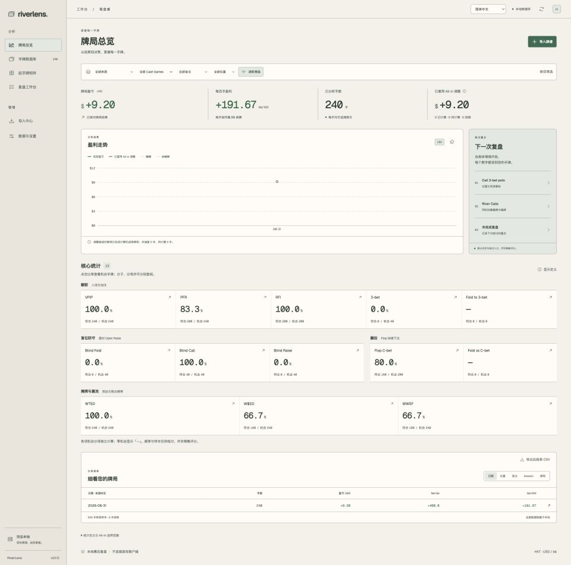
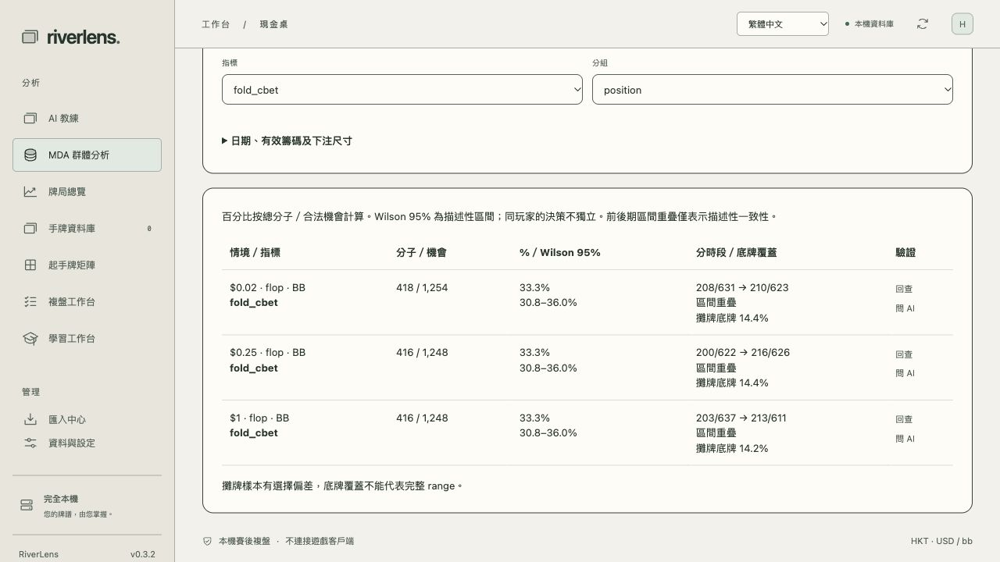

<div align="center">

# RiverLens

**你的牌谱，你的资料。本机优先的赛后扑克复盘工作台。**

汇入自己完成的牌谱（支援 20+ 牌室）、研究群体倾向、用真实证据找 leak，
再把 leak 练成记忆——全程离线，资料不离开你的电脑，除非你主动开启分享。

[](https://github.com/G-Loop-co/riverlens/releases/latest)
[](https://github.com/G-Loop-co/riverlens/actions/workflows/desktop.yml)


**[⬇️ 下载 RiverLens v0.6.0](https://github.com/G-Loop-co/riverlens/releases/latest)** ·
Windows 安装档 · macOS Apple Silicon · macOS Intel

<sub>macOS 版本为 ad-hoc 签章，未经 Apple notarization。[发布说明](docs/release-v0.6.0.md)。</sub>



</div>

[English](README.md) · [繁体中文](README.zh-TW.md) · [简体中文](README.zh-CN.md) · [日本语](README.ja.md) · [한국어](README.ko.md) · [Français](README.fr.md) · [Deutsch](README.de.md) · [Español](README.es.md) · [Português (Brasil)](README.pt-BR.md) · [Italiano](README.it.md) · [Nederlands](README.nl.md) · [Polski](README.pl.md) · [Türkçe](README.tr.md)

---

## 为什么选 RiverLens

| | |
| --- | --- |
| 🔒 **本机优先，设计如此** | 个人复盘存 SQLite，群体研究存独立 DuckDB。无帐号、无云端同步、无遥测。AI 与资料集分享皆为选用，预设关闭。 |
| 🧪 **证据，不是感觉** | 每个频率都附合法机会分母、Wilson 95% 区间，并可下钻匿名手牌。缺基线就标示为研究假设——绝不直接说「你有 leak」。 |
| 🌍 **20+ 牌室与网络** | GG／Natural8、PokerStars、WPN、888、partypoker、Winamax、iPoker 等原生解析器，Cash 与锦标赛——见[完整表格](#支援牌室)。 |
| 🤖 **有凭有据的 AI** | 23 个本机 MCP 工具供你的 agent 使用，或用内建教练（OpenAI／Anthropic／Gemini／DeepSeek／OpenCode Go）。AI 的每个主张都连回手牌证据，并需你批准。 |
| 🧠 **闭环的学习流程** | Spot Explorer → Leak Finder → GTO 对照 → Range 操练 → Trainer 间隔复习——现在还有 leak 趋势快照，让你看见 leak 正在收敛。 |
| 📊 **严谨数字，诚实标示** | 13 项核心统计、13×13 矩阵、精确枚举 all-in equity。不是 decision EV 的东西就标明不是。 |

## 学习闭环

```text
汇入 → 情境探索 → 找 leak → GTO 对照 → 操练复习 → 追踪趋势
```

1. **汇入**自己完成的牌谱（TXT／XML／ZIP／资料夹）——可暂停、续汇、去重、隔离。
2. **探索**任何决策情境：位置、底池、筹码、下注尺寸、牌面、完整行动路径。
3. **找 leak**：对照自订目标或 GTO 策略包，Wilson 区间诚实呈现样本限制。
4. **操练**：Range 操练逐组合分配频率，或复习由自己决策与 AI 草稿产生的 Trainer 间隔题卡。
5. **追踪**：leak 趋势快照画出频率是否真的在收敛——全部可汇出 CSV。

<details>
<summary><strong>📸 更多截图</strong></summary>




截图以 1920px 桌面宽度、Paper（暖白）主题拍摄完整页面，使用 **240 手生成牌**——非私人资料。另有 [1920 × 1080 总览](docs/screenshots/overview-desktop-en.jpg)。

</details>

## v0.6.0 新功能

- 📈 **Leak 趋势快照** — 随时记录目标快照；快照由引擎以索引帐本重算（不信任页面端数字），并将实际频率对照目标区间画成趋势图。
- 📤 **学习记录汇出** — 练习记录、操练记录与 leak 快照可汇出为全新 CSV。
- 🌏 **MDA 完整本地化** — MDA 工作台与研究向导现在支援 English／繁体中文／简体中文。
- 🤖 **AI 草稿 → Trainer** — AI 教练的练习草稿转为间隔复习题卡；研究向导按假设 → Wilson 区间 → 匿名手牌验证 → AI 剥削分析逐步引导。

<details>
<summary><strong>历史版本</strong></summary>

- **v0.5.0** — AI 练习草稿 → Trainer 题卡；Range 操练对照策略包节点；MDA 研究向导；一页学习进度仪表板。
- **v0.4.x** — 独立 DuckDB 的 MDA 群体分析、AI／MCP 整合、多牌室 Cash 与锦标赛牌谱。

[全部发布说明](https://github.com/G-Loop-co/riverlens/releases)

</details>

## 支援牌室

个人复盘：English NLHE、2–10 席、UTF-8；Cash 与支援的锦标赛。MDA 群体研究限定 GG 一般桌 USD NLH 6-max。汇入 TXT／XML／ZIP／资料夹——永不连接游戏客户端。

<details>
<summary><strong>完整牌室／网络表</strong></summary>

| 牌室／网络 | Cash 汇入 | MTT／锦标赛 | 支援范围 |
| --- | --- | --- | --- |
| GG / Natural8 | TXT | Yes | 原生语法 |
| PokerStars | TXT | Yes | 原生语法 |
| WPN / ACR / Black Chip / PokerKing | TXT（旧＋新） | 仅新格式 | 原生语法 |
| 888 / Pacific | TXT | Yes | 原生语法 |
| partypoker / bwin | TXT | — | 原生语法 |
| Winamax | TXT | Yes | 原生语法 |
| iPoker skins | XML | Yes | 原生语法 |
| CoinPoker | TXT (USDT) | — | 原生语法；仅合成验证 |
| Ignition / Bovada / Bodog | TXT | — | 原生语法 |
| Unibet | TXT | — | 原生语法 |
| Full Tilt | TXT | Yes | 历史原生语法 |
| Cake / Revolution | TXT | — | 历史原生语法 |
| OnGame | TXT | — | 历史原生语法 |
| Merge / Carbon | XML | — | 历史原生语法 |
| Microgaming / MPN | XML | — | 历史原生语法 |
| Chico / BetOnline / SportsBetting / TigerGaming | PokerStars TXT | — | 仅既有完整转换 |
| PPPoker / PokerBros / UPoker / ClubGG / X-Poker / QQPK | PokerStars TXT | — | 仅既有完整转换 |
| WPT Global | PokerStars TXT | — | 仅既有完整转换 |

</details>

「—」表示该列尚未实作锦标赛解析。转换格式需既有完整 PokerStars Cash 汇出。MTT 金额以 CHIPS 储存，绝不与现金混用；all-in chip EV 不是奖金、ROI、ICM 或 bounty EV。[汇出指南与精确限制](docs/hand-history-formats.md)。

## 有凭有据的 AI

两种接入方式——都连证据、都需你批准才会保存：

| | 内建教练 | 外部 agent（MCP） |
| --- | --- | --- |
| **设定** | 在 AI 连接页存 API key（OpenAI／Anthropic／Gemini／DeepSeek／OpenCode Go） | 开启本机连接，将任何 stdio-MCP 用户端（如 Codex）指向它 |
| **金钥存放** | OS 凭证库 | agent 自己的登入——RiverLens 不保管 provider 金钥 |
| **工具** | 5 个限域群体工具＋完整学习工具 | 23 个本机 MCP 工具 |
| **产出** | 学习资料库中的证据草稿 | 同样的草稿，由你的 agent 驱动 |

Live provider 通话仍未验证；离线学习不需任何金钥。[完整设定与限制](docs/ai-agent-coach.md)。

<details>
<summary><strong>MDA 群体研究四步</strong></summary>

1. 建立独立资料集并设定牌谱时区；汇入 GG 一般桌 USD NLH 6-max 的 TXT／ZIP／资料夹。
2. 筛选级别、位置、底池、筹码、牌面与面对下注尺寸；翻后预设 HU。
3. 查看带合法机会分母的频率、Wilson 95% 区间与分时段资料；用匿名手牌验证。
4. 依资料集启用云端 AI 或 MCP（预设关闭），要求附证据的调整方向。

千万手合成基准通过（Apple M3 Pro）：汇总 p95 **16.4 ms**、情境 p95 **1.20 s**、峰值 RSS **1.39 GiB**。[完整证据](docs/validation/mda-population-ai.md)。

</details>

## RiverLens 不是什么

这是信任型产品，所以界线本身就是功能：

- ❌ 无 live HUD、即时协助或游戏客户端连接
- ❌ 无云端同步、帐号或遥测——删除就是真的删除
- ❌ 无 decision EV、GTO 最佳行动评分或「信心度」表演
- ❌ 与 Natural8／GGPoker 无关；GG 安全与生态政策第 7／19 条限制收集他人牌谱与系统化 MDA 分享——RiverLens 只汇入**你自己**完成的牌局，资料集分享预设关闭。[详情](docs/mda-population.md)。

## Roadmap 路线图

规划方向，不是承诺，不附日期。范围纪律不变。

### 近期（v0.6.x）

- Trainer 自适应排程（FSRS），以现有 1/3/7/14/30 天间隔为起点。
- 翻后操练题型：来自使用者策略包或 MDA 群体基线，一律标示为倾向、非 GTO。

### 中期

- 超越 NL10 100bb manifest 的级别与 rake 感知策略对照。
- HHDealer PT／HM／H2N4 汇入（待真实样本验证）；PHH／OHH／ACPC 研究格式。
- Live provider 通话验证与更广的打包客户端冒烟覆盖。
- 更深的 AI ↔ Trainer 闭环：学习计划草稿自动排入练习题库。

### 探索中

- 锦标赛情境 equity（ICM／bounty 属奖金 EV，现阶段不在范围）。
- 已储存的 MDA 研究范本与假设库。
- 应内统计教育，每项指标附工作示例。

### 不做

Live HUD／即时协助、私人牌谱云端同步、solver 授权或 decision EV 主张。

## 从原始码建置

需要 Node.js 22+、Rust stable 与 [Tauri 平台需求](https://v2.tauri.app/start/prerequisites/)。

```sh
git clone https://github.com/G-Loop-co/riverlens.git
cd riverlens
npm ci
npm run desktop
```

1. 汇出自己完成的牌谱（如 PokerCraft TXT／ZIP）。
2. 在「资料与设定」确认品牌、Hero 名称与牌谱内文时区。
3. 于「汇入中心」汇入，即可检视结果、13×13 矩阵与逐手回放。

```sh
npm test          # 前端测试
npm run core:test # Rust 核心测试
npm run build     # 严格正式建置
```

资料存放于 Tauri app-data 目录（`app.riverlens.desktop`）；设定页显示实际位置。作用中资料库请用内建备份，确保 SQLite WAL 正确处理。

## 文档

- [使用说明](docs/user-guide.md)
- [架构与统计定义](docs/architecture.md)
- [学习工作台流程](docs/study-workflow.md)
- [牌谱格式与汇出指南](docs/hand-history-formats.md)
- [AI 教练与 MCP 设定](docs/ai-agent-coach.md)
- [MDA 限制与验证关卡](docs/mda-population.md)
- [验证与限制](docs/validation.md)
- [更新日志](CHANGELOG.md) · [第三方元件](THIRD_PARTY.md) · [所有版本](https://github.com/G-Loop-co/riverlens/releases)

## 授权

仓库公开，但尚未选定整专案重用授权。请勿假设 RiverLens 采 MIT 或 Apache 授权。第三方元件保留各自授权，见 [THIRD_PARTY.md](THIRD_PARTY.md)。
