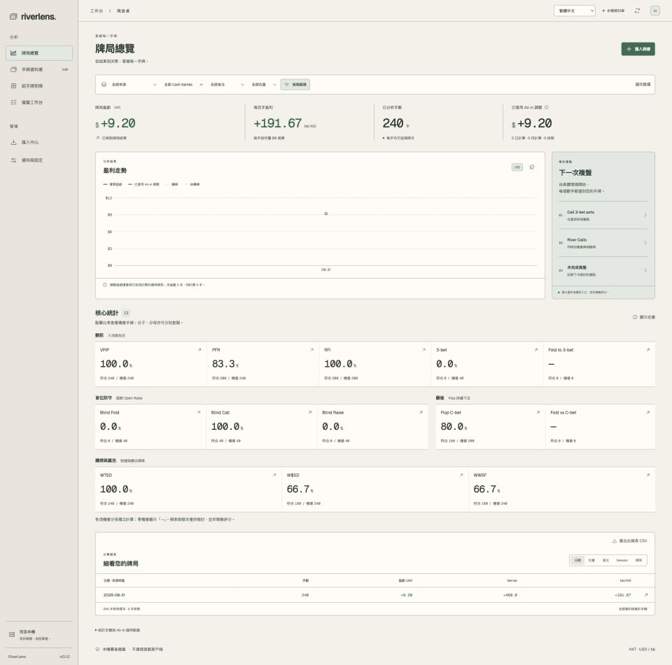
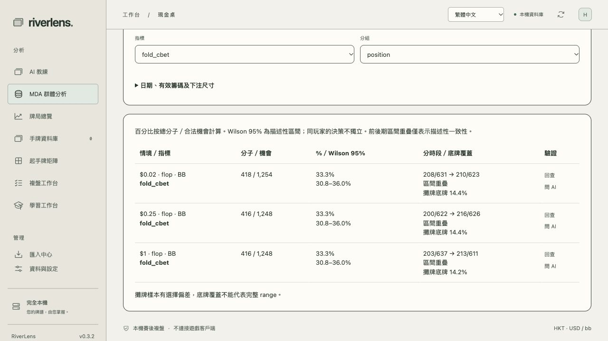

<div align="center">

# RiverLens

**你的牌譜，你的資料。本機優先的賽後撲克複盤工作台。**

匯入自己完成的牌譜（支援 20+ 牌室）、研究群體傾向、用真實證據找 leak，
再把 leak 練成記憶——全程離線，資料不離開你的電腦，除非你主動開啟分享。

[](https://github.com/G-Loop-co/riverlens/releases/latest)
[](https://github.com/G-Loop-co/riverlens/actions/workflows/desktop.yml)


**[⬇️ 下載 RiverLens v0.6.0](https://github.com/G-Loop-co/riverlens/releases/latest)** ·
Windows 安裝檔 · macOS Apple Silicon · macOS Intel

<sub>macOS 版本為 ad-hoc 簽章，未經 Apple notarization。[發布說明](docs/release-v0.6.0.md)。</sub>



</div>

[English](README.md) · [繁體中文](README.zh-TW.md) · [简体中文](README.zh-CN.md) · [日本語](README.ja.md) · [한국어](README.ko.md) · [Français](README.fr.md) · [Deutsch](README.de.md) · [Español](README.es.md) · [Português (Brasil)](README.pt-BR.md) · [Italiano](README.it.md) · [Nederlands](README.nl.md) · [Polski](README.pl.md) · [Türkçe](README.tr.md)

---

## 為什麼選 RiverLens

| | |
| --- | --- |
| 🔒 **本機優先，設計如此** | 個人複盤存 SQLite，群體研究存獨立 DuckDB。無帳號、無雲端同步、無遙測。AI 與資料集分享皆為選用，預設關閉。 |
| 🧪 **證據，不是感覺** | 每個頻率都附合法機會分母、Wilson 95% 區間，並可下鑽匿名手牌。缺基線就標示為研究假設——絕不直接說「你有 leak」。 |
| 🌍 **20+ 牌室與網絡** | GG／Natural8、PokerStars、WPN、888、partypoker、Winamax、iPoker 等原生解析器，Cash 與錦標賽——見[完整表格](#支援牌室)。 |
| 🤖 **有憑有據的 AI** | 23 個本機 MCP 工具供你的 agent 使用，或用內建教練（OpenAI／Anthropic／Gemini／DeepSeek／OpenCode Go）。AI 的每個主張都連回手牌證據，並需你批准。 |
| 🧠 **閉環的學習流程** | Spot Explorer → Leak Finder → GTO 對照 → Range 操練 → Trainer 間隔複習——現在還有 leak 趨勢快照，讓你看見 leak 正在收斂。 |
| 📊 **嚴謹數字，誠實標示** | 13 項核心統計、13×13 矩陣、精確枚舉 all-in equity。不是 decision EV 的東西就標明不是。 |

## 學習閉環

```text
匯入 → 情境探索 → 找 leak → GTO 對照 → 操練複習 → 追蹤趨勢
```

1. **匯入**自己完成的牌譜（TXT／XML／ZIP／資料夾）——可暫停、續匯、去重、隔離。
2. **探索**任何決策情境：位置、底池、籌碼、下注尺寸、牌面、完整行動路徑。
3. **找 leak**：對照自訂目標或 GTO 策略包，Wilson 區間誠實呈現樣本限制。
4. **操練**：Range 操練逐組合分配頻率，或複習由自己決策與 AI 草稿產生的 Trainer 間隔題卡。
5. **追蹤**：leak 趨勢快照畫出頻率是否真的在收斂——全部可匯出 CSV。

<details>
<summary><strong>📸 更多截圖</strong></summary>




截圖以 1920px 桌面寬度、Paper（暖白）主題拍攝完整頁面，使用 **240 手生成牌**——非私人資料。另有 [1920 × 1080 總覽](docs/screenshots/overview-desktop-en.jpg)。

</details>

## v0.6.0 新功能

- 📈 **Leak 趨勢快照** — 隨時記錄目標快照；快照由引擎以索引帳本重算（不信任頁面端數字），並將實際頻率對照目標區間畫成趨勢圖。
- 📤 **學習記錄匯出** — 練習記錄、操練記錄與 leak 快照可匯出為全新 CSV。
- 🌏 **MDA 完整本地化** — MDA 工作台與研究嚮導現在支援 English／繁體中文／简体中文。
- 🤖 **AI 草稿 → Trainer** — AI 教練的練習草稿轉為間隔複習題卡；研究嚮導按假設 → Wilson 區間 → 匿名手牌驗證 → AI 剝削分析逐步引導。

<details>
<summary><strong>歷史版本</strong></summary>

- **v0.5.0** — AI 練習草稿 → Trainer 題卡；Range 操練對照策略包節點；MDA 研究嚮導；一頁學習進度儀表板。
- **v0.4.x** — 獨立 DuckDB 的 MDA 群體分析、AI／MCP 整合、多牌室 Cash 與錦標賽牌譜。

[全部發布說明](https://github.com/G-Loop-co/riverlens/releases)

</details>

## 支援牌室

個人複盤：English NLHE、2–10 席、UTF-8；Cash 與支援的錦標賽。MDA 群體研究限定 GG 一般桌 USD NLH 6-max。匯入 TXT／XML／ZIP／資料夾——永不連接遊戲客戶端。

<details>
<summary><strong>完整牌室／網絡表</strong></summary>

| 牌室／網絡 | Cash 匯入 | MTT／錦標賽 | 支援範圍 |
| --- | --- | --- | --- |
| GG / Natural8 | TXT | Yes | 原生語法 |
| PokerStars | TXT | Yes | 原生語法 |
| WPN / ACR / Black Chip / PokerKing | TXT（舊＋新） | 僅新格式 | 原生語法 |
| 888 / Pacific | TXT | Yes | 原生語法 |
| partypoker / bwin | TXT | — | 原生語法 |
| Winamax | TXT | Yes | 原生語法 |
| iPoker skins | XML | Yes | 原生語法 |
| CoinPoker | TXT (USDT) | — | 原生語法；僅合成驗證 |
| Ignition / Bovada / Bodog | TXT | — | 原生語法 |
| Unibet | TXT | — | 原生語法 |
| Full Tilt | TXT | Yes | 歷史原生語法 |
| Cake / Revolution | TXT | — | 歷史原生語法 |
| OnGame | TXT | — | 歷史原生語法 |
| Merge / Carbon | XML | — | 歷史原生語法 |
| Microgaming / MPN | XML | — | 歷史原生語法 |
| Chico / BetOnline / SportsBetting / TigerGaming | PokerStars TXT | — | 僅既有完整轉換 |
| PPPoker / PokerBros / UPoker / ClubGG / X-Poker / QQPK | PokerStars TXT | — | 僅既有完整轉換 |
| WPT Global | PokerStars TXT | — | 僅既有完整轉換 |

</details>

「—」表示該列尚未實作錦標賽解析。轉換格式需既有完整 PokerStars Cash 匯出。MTT 金額以 CHIPS 儲存，絕不與現金混用；all-in chip EV 不是獎金、ROI、ICM 或 bounty EV。[匯出指南與精確限制](docs/hand-history-formats.md)。

## 有憑有據的 AI

兩種接入方式——都連證據、都需你批准才會保存：

| | 內建教練 | 外部 agent（MCP） |
| --- | --- | --- |
| **設定** | 在 AI 連接頁存 API key（OpenAI／Anthropic／Gemini／DeepSeek／OpenCode Go） | 開啟本機連接，將任何 stdio-MCP 用戶端（如 Codex）指向它 |
| **金鑰存放** | OS 憑證庫 | agent 自己的登入——RiverLens 不保管 provider 金鑰 |
| **工具** | 5 個限域群體工具＋完整學習工具 | 23 個本機 MCP 工具 |
| **產出** | 學習資料庫中的證據草稿 | 同樣的草稿，由你的 agent 驅動 |

Live provider 通話仍未驗證；離線學習不需任何金鑰。[完整設定與限制](docs/ai-agent-coach.md)。

<details>
<summary><strong>MDA 群體研究四步</strong></summary>

1. 建立獨立資料集並設定牌譜時區；匯入 GG 一般桌 USD NLH 6-max 的 TXT／ZIP／資料夾。
2. 篩選級別、位置、底池、籌碼、牌面與面對下注尺寸；翻後預設 HU。
3. 查看帶合法機會分母的頻率、Wilson 95% 區間與分時段資料；用匿名手牌驗證。
4. 依資料集啟用雲端 AI 或 MCP（預設關閉），要求附證據的調整方向。

千萬手合成基準通過（Apple M3 Pro）：彙總 p95 **16.4 ms**、情境 p95 **1.20 s**、峰值 RSS **1.39 GiB**。[完整證據](docs/validation/mda-population-ai.md)。

</details>

## RiverLens 不是什麼

這是信任型產品，所以界線本身就是功能：

- ❌ 無 live HUD、即時協助或遊戲客戶端連接
- ❌ 無雲端同步、帳號或遙測——刪除就是真的刪除
- ❌ 無 decision EV、GTO 最佳行動評分或「信心度」表演
- ❌ 與 Natural8／GGPoker 無關；GG 安全與生態政策第 7／19 條限制收集他人牌譜與系統化 MDA 分享——RiverLens 只匯入**你自己**完成的牌局，資料集分享預設關閉。[詳情](docs/mda-population.md)。

## Roadmap 路線圖

規劃方向，不是承諾，不附日期。範圍紀律不變。

### 近期（v0.6.x）

- Trainer 自適應排程（FSRS），以現有 1/3/7/14/30 天間隔為起點。
- 翻後操練題型：來自使用者策略包或 MDA 群體基線，一律標示為傾向、非 GTO。

### 中期

- 超越 NL10 100bb manifest 的級別與 rake 感知策略對照。
- HHDealer PT／HM／H2N4 匯入（待真實樣本驗證）；PHH／OHH／ACPC 研究格式。
- Live provider 通話驗證與更廣的打包客戶端冒煙覆蓋。
- 更深的 AI ↔ Trainer 閉環：學習計畫草稿自動排入練習題庫。

### 探索中

- 錦標賽情境 equity（ICM／bounty 屬獎金 EV，現階段不在範圍）。
- 已儲存的 MDA 研究範本與假設庫。
- 應內統計教育，每項指標附工作示例。

### 不做

Live HUD／即時協助、私人牌譜雲端同步、solver 授權或 decision EV 主張。

## 從原始碼建置

需要 Node.js 22+、Rust stable 與 [Tauri 平台需求](https://v2.tauri.app/start/prerequisites/)。

```sh
git clone https://github.com/G-Loop-co/riverlens.git
cd riverlens
npm ci
npm run desktop
```

1. 匯出自己完成的牌譜（如 PokerCraft TXT／ZIP）。
2. 在「資料與設定」確認品牌、Hero 名稱與牌譜內文時區。
3. 於「匯入中心」匯入，即可檢視結果、13×13 矩陣與逐手回放。

```sh
npm test          # 前端測試
npm run core:test # Rust 核心測試
npm run build     # 嚴格正式建置
```

資料存放於 Tauri app-data 目錄（`app.riverlens.desktop`）；設定頁顯示實際位置。作用中資料庫請用內建備份，確保 SQLite WAL 正確處理。

## 文檔

- [使用說明](docs/user-guide.md)
- [架構與統計定義](docs/architecture.md)
- [學習工作台流程](docs/study-workflow.md)
- [牌譜格式與匯出指南](docs/hand-history-formats.md)
- [AI 教練與 MCP 設定](docs/ai-agent-coach.md)
- [MDA 限制與驗證關卡](docs/mda-population.md)
- [驗證與限制](docs/validation.md)
- [更新日誌](CHANGELOG.md) · [第三方元件](THIRD_PARTY.md) · [所有版本](https://github.com/G-Loop-co/riverlens/releases)

## 授權

倉庫公開，但尚未選定整專案重用授權。請勿假設 RiverLens 採 MIT 或 Apache 授權。第三方元件保留各自授權，見 [THIRD_PARTY.md](THIRD_PARTY.md)。
